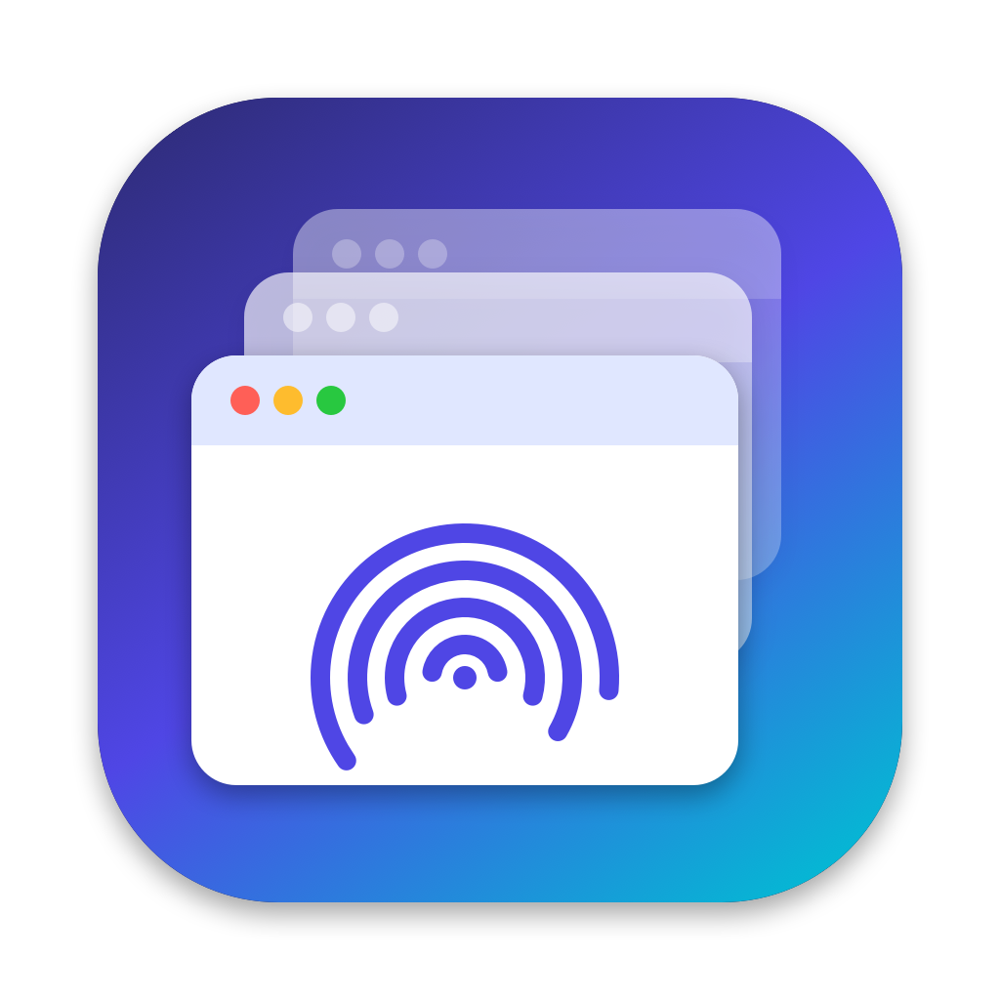

# BrowserDeck

**English** · [Русский](README.ru.md)

<p align="center"></p>

A native macOS app for managing isolated Google Chrome profiles. Every profile is a
separate Chrome instance with its own data folder. Cookies, cache, history, logins,
open tabs and extensions are kept apart from other profiles and saved between runs.

It works like a lightweight "multi-account browser". It runs your installed Chrome
with per-profile settings and does not use a modified browser engine.

> The interface is in Russian.

## Features

**Profiles**
- Any number of profiles. You can create them one at a time or up to 100 at once,
  with a name prefix, random User-Agents and a list of proxies to spread across them.
- Launch or close the selected profiles, or all of them. Windows can be tiled in a
  grid across the screen.
- Running profiles are detected through Chrome's own lock file, including profiles
  started before BrowserDeck itself.
- Duplicate a profile's settings, reveal its folder in Finder, clear its cache, or
  delete it. Deleted profile folders go to the Trash and can be recovered.

**Per-profile settings**
- **User-Agent:** presets for macOS, Windows and Linux, built from the Chrome version
  you have installed. You can also enter your own.
- **Language:** `Accept-Language` and `navigator.language`.
- **Time zone**, set through the `TZ` environment variable of the Chrome process.
- **Proxy:** http, https, socks4 or socks5.
- **WebRTC IP leak protection.**
- Start page, window size and notes.

**Sessions and data**
- Each launch reopens the tabs that were open last time.
- The start page opens only on the very first launch.
- Profiles always close gracefully. A frozen profile is resumed first, then Chrome
  gets up to 20 seconds to exit on its own and is never force-killed. This gives
  Chrome time to save history, cookies and the session.

**Low memory and CPU use**
- Three modes per profile:

  | Mode | What it does |
  |---|---|
  | Standard | Plain Chrome. |
  | Economy (default) | Turns off background services, smooth scrolling and animations, and enables Memory Saver. |
  | Maximum | Economy, plus fewer renderer processes, low-end device mode, Energy Saver and aggressive tab discarding. |

- An optional switch blocks images.
- Live memory and CPU use is shown for each running profile and as a total.

**Freezing**
- **Freeze:** pauses the whole Chrome process tree of a profile, so it uses 0% CPU.
  The tabs and memory stay intact.
- **Auto-freeze (on by default):**
  - A Chrome window that has not been used for 5 minutes freezes on its own. The
    delay can be set to 2, 5, 10 or 30 minutes, or auto-freeze can be turned off.
  - A frozen window wakes up when you click it, switch to it with ⌘Tab or the Dock,
    or open it from BrowserDeck.
  - Auto-freeze can be turned off for a single profile, for pages that must keep
    running in the background.

**Window labels**
- Every Chrome window shows a small label with the profile name in its corner.
- The Chrome window frame is tinted in the profile's colour, so profiles are easy to
  tell apart.

Measured on Chrome 157 on an idle page: Standard used about 410 MB and 15% CPU,
Maximum used about 360 MB and under 1% CPU. A frozen profile uses 0% CPU.

## Requirements

- macOS 14 or later, on Apple Silicon.
- Google Chrome in `/Applications` or `~/Applications`. Chromium also works.
- Xcode Command Line Tools: `xcode-select --install`. No Xcode project is needed.

## Build and install

```bash
git clone https://github.com/Gainslean/BrowserDeck.git
cd BrowserDeck
./build.sh            # → build/BrowserDeck.app
./build.sh install    # also copies it to ~/Applications
```

The app is signed ad-hoc. On first launch macOS may ask you to confirm opening it:
right-click the app and choose **Open**.

## Usage

1. Click **+** to create a profile, or the batch button to create several at once.
2. Pick a profile and set its User-Agent, language, time zone, proxy and mode.
3. Press **▶** to launch the selected profiles, or all of them when none is selected.
   Double-clicking a profile also launches it.
4. Right-click a profile for more actions: close, freeze or unfreeze, duplicate,
   reveal in Finder, clear cache or delete.

BrowserDeck keeps running after you close its window, because window labels and
auto-freeze depend on it. Quit with ⌘Q. Quitting resumes any frozen profiles.

## Where data is stored

| What | Where |
|---|---|
| Profile list | `~/Library/Application Support/BrowserDeck/profiles.json` |
| Chrome data | `~/Library/Application Support/BrowserDeck/Profiles/<id>/` |
| Chrome cache | `~/Library/Caches/BrowserDeck/Profiles/<id>/` |

Nothing is sent anywhere. The app has no network code, telemetry or accounts.

## Limitations

- `navigator.platform` and Client Hints (`navigator.userAgentData`) still report
  macOS, because Chrome's flags cannot change them. A macOS User-Agent is the most
  consistent choice.
- Canvas, WebGL, fonts and hardware details are not spoofed. It is regular Chrome.
- Proxies that need a username and password cannot be set through Chrome flags. Use
  a proxy with IP-based access.
- Window labels and auto-freeze work only while BrowserDeck is running.

## How it works

- Each profile is started as `Google Chrome --user-data-dir=<profile folder>` with
  flags for the User-Agent, language, proxy, WebRTC policy, window position and
  performance mode.
- Before launch, the profile's `Preferences` and `Local State` files are updated:
  restore last session, languages, WebRTC policy, Memory and Energy Saver, profile
  name and theme colour.
- Memory and CPU are read with `libproc` for the whole process tree of each profile.
- Freezing sends `SIGSTOP` and `SIGCONT` to every process in the tree.
- Window labels are borderless, click-through panels placed over Chrome's windows,
  which are found with `CGWindowListCopyWindowInfo`.

## Project structure

| File | Purpose |
|---|---|
| `Sources/BrowserDeckApp.swift` | App entry point |
| `Sources/Models.swift` | Profile model |
| `Sources/ProfileStore.swift` | Profile list and profile folders |
| `Sources/LaunchConfig.swift` | Chrome flags, Preferences, window layout |
| `Sources/ChromeLauncher.swift` | Tracking running profiles and their resource use |
| `Sources/ProfileControl.swift` | Launch, close, freeze |
| `Sources/AutoFreezer.swift` | Auto-freeze of unused windows |
| `Sources/WindowBadges.swift` | Profile name labels on Chrome windows |
| `Sources/Performance.swift` | Economy modes: flags and Chrome settings |
| `Sources/ResourceMonitor.swift` | Memory and CPU of a profile's processes |
| `Sources/Presets.swift` | User-Agent, language and time zone presets |
| `Sources/ContentView.swift`, `ProfileEditor.swift`, `SupportViews.swift` | Interface |
| `scripts/make_icon.swift` | Draws the app icon |
| `build.sh` | Builds and installs the app |

## Disclaimer

BrowserDeck is meant for keeping separate work, test and personal browsing
identities apart. Follow the terms of service of the sites you use.
