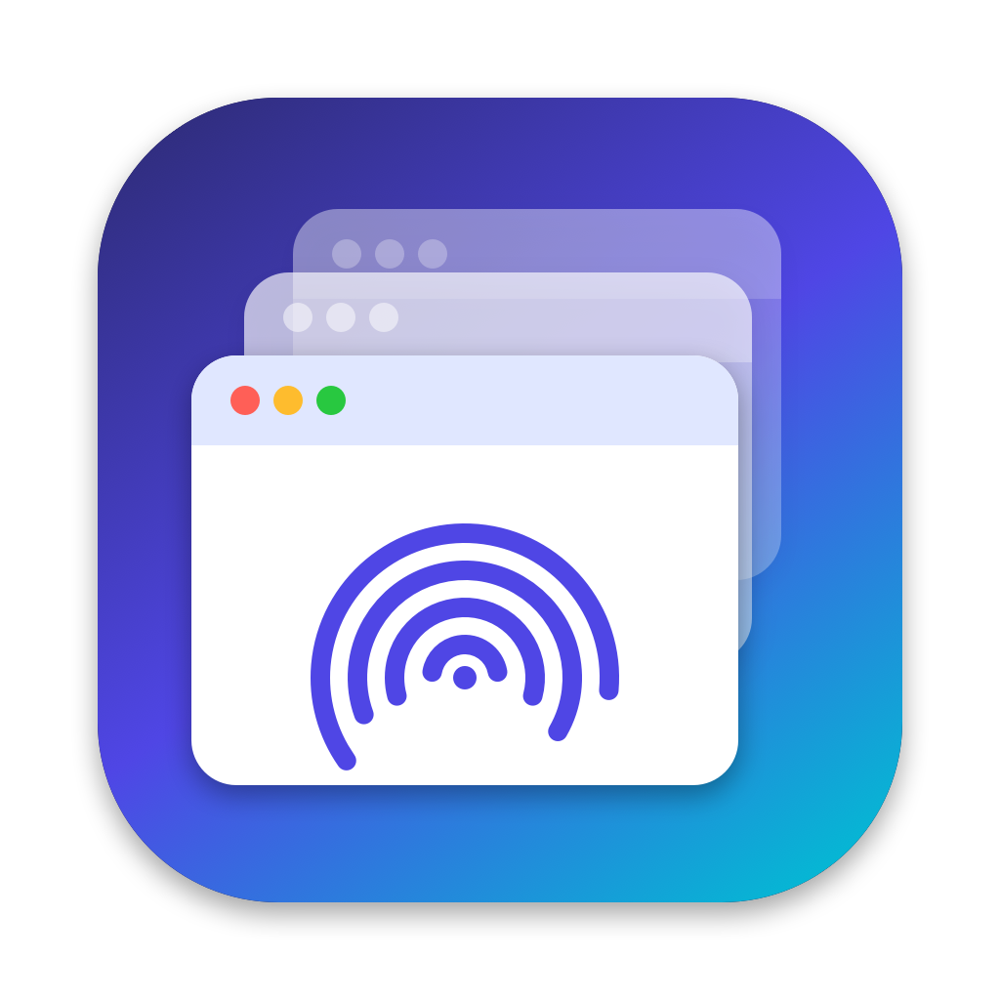

# BrowserDeck

[English](README.md) · **Русский**

<p align="center"></p>

Нативное приложение для macOS, которое управляет изолированными профилями Google Chrome.
Каждый профиль — отдельный экземпляр Chrome со своей папкой данных. Куки, кеш, история,
логины, открытые вкладки и расширения не смешиваются с другими профилями и сохраняются
между запусками.

Это лёгкий «мультиаккаунт-браузер». Он запускает установленный у вас Chrome с настройками
профиля и не использует изменённый движок браузера.

## Возможности

**Профили**
- Сколько угодно профилей. Их можно создавать по одному или до 100 за раз, с префиксом
  имени, случайными User-Agent и списком прокси, который распределяется по профилям.
- Запуск и закрытие выбранных профилей или всех сразу. Окна можно разложить сеткой по
  экрану.
- Открытые профили определяются по lock-файлу самого Chrome, в том числе запущенные до
  старта BrowserDeck.
- Дублирование настроек, показ папки в Finder, очистка кеша и удаление. Папки удалённых
  профилей уходят в Корзину, их можно вернуть.

**Настройки каждого профиля**
- **User-Agent:** готовые варианты для macOS, Windows и Linux под установленную версию
  Chrome. Можно ввести свой.
- **Язык:** `Accept-Language` и `navigator.language`.
- **Часовой пояс** через переменную окружения `TZ` процесса Chrome.
- **Прокси:** http, https, socks4 или socks5.
- **Защита от утечки IP через WebRTC.**
- Стартовая страница, размер окна и заметки.

**Сессии и данные**
- При каждом запуске открываются вкладки, которые были открыты в прошлый раз.
- Стартовая страница открывается только при самом первом запуске.
- Профили всегда закрываются штатно. Замороженный профиль сначала размораживается, потом
  Chrome даётся до 20 секунд, чтобы закрыться самому, и он никогда не убивается
  принудительно. Так Chrome успевает записать историю, куки и сессию.

**Мало памяти и процессора**
- Три режима для каждого профиля:

  | Режим | Что делает |
  |---|---|
  | Обычный | Обычный Chrome. |
  | Экономный (по умолчанию) | Выключает фоновые службы, плавную прокрутку и анимации, включает экономию памяти. |
  | Максимальный | То же, что экономный, плюс меньше процессов отрисовки, режим слабого устройства, экономия энергии и активная выгрузка вкладок. |

- Отдельный переключатель отключает загрузку картинок.
- Расход памяти и процессора виден по каждому открытому профилю и суммарно.

**Заморозка**
- **Заморозка:** ставит на паузу все процессы Chrome этого профиля, процессор 0%.
  Вкладки и память остаются на месте.
- **Автозаморозка (включена по умолчанию):**
  - Окно Chrome, которым не пользуются 5 минут, замораживается само. Время можно
    поставить на 2, 5, 10 или 30 минут либо выключить автозаморозку.
  - Замороженное окно просыпается, если кликнуть по нему, переключиться на него через
    ⌘Tab или Dock или открыть его из BrowserDeck.
  - Для отдельного профиля автозаморозку можно отключить, если страница должна работать
    в фоне.

**Подписи окон**
- На каждом окне Chrome в углу видна плашка с названием профиля.
- Рамка окна Chrome окрашена в цвет профиля, поэтому профили легко различать.

Замер на Chrome 157 на странице без активности: обычный режим занимал около 410 МБ и 15%
процессора, максимальный — около 360 МБ и меньше 1%. Замороженный профиль — 0% процессора.

## Требования

- macOS 14 или новее, Apple Silicon.
- Google Chrome в `/Applications` или `~/Applications`. Chromium тоже подойдёт.
- Xcode Command Line Tools: `xcode-select --install`. Проект Xcode не нужен.

## Сборка и установка

```bash
git clone https://github.com/Gainslean/BrowserDeck.git
cd BrowserDeck
./build.sh            # → build/BrowserDeck.app
./build.sh install    # и копия в ~/Applications
```

Приложение подписано ad-hoc. При первом запуске macOS может попросить подтвердить
открытие: нажмите на приложение правой кнопкой и выберите **Открыть**.

## Как пользоваться

1. Нажмите **+**, чтобы создать профиль, или кнопку пакетного создания, чтобы создать
   несколько сразу.
2. Выберите профиль и задайте User-Agent, язык, часовой пояс, прокси и режим.
3. Нажмите **▶**, чтобы запустить выбранные профили или все, если ничего не выбрано.
   Профиль также запускается двойным кликом.
4. Правый клик по профилю открывает остальные действия: закрыть, заморозить или
   разморозить, дублировать, показать в Finder, очистить кеш, удалить.

Если закрыть окно BrowserDeck, приложение продолжает работать, потому что от него зависят
подписи окон и автозаморозка. Выход — ⌘Q. При выходе замороженные профили
размораживаются.

## Где хранятся данные

| Что | Где |
|---|---|
| Список профилей | `~/Library/Application Support/BrowserDeck/profiles.json` |
| Данные Chrome | `~/Library/Application Support/BrowserDeck/Profiles/<id>/` |
| Кеш Chrome | `~/Library/Caches/BrowserDeck/Profiles/<id>/` |

Ничего никуда не отправляется. В приложении нет сетевого кода, телеметрии и аккаунтов.

## Ограничения

- `navigator.platform` и Client Hints (`navigator.userAgentData`) остаются macOS: флаги
  Chrome их не меняют. Самый правдоподобный выбор — User-Agent для macOS.
- Canvas, WebGL, шрифты и данные о железе не подменяются. Это обычный Chrome.
- Прокси с логином и паролем нельзя задать через флаги Chrome. Нужен прокси с доступом
  по IP.
- Подписи окон и автозаморозка работают, только пока запущен BrowserDeck.

## Как это устроено

- Каждый профиль запускается как `Google Chrome --user-data-dir=<папка профиля>` с
  флагами для User-Agent, языка, прокси, политики WebRTC, положения окна и режима
  экономии.
- Перед запуском обновляются файлы профиля `Preferences` и `Local State`: восстановление
  прошлой сессии, языки, политика WebRTC, экономия памяти и энергии, имя профиля и цвет
  темы.
- Память и процессор считываются через `libproc` по всему дереву процессов профиля.
- Заморозка отправляет `SIGSTOP` и `SIGCONT` каждому процессу дерева.
- Подписи — это панели без рамки, сквозь которые проходят клики. Они размещаются поверх
  окон Chrome, которые находятся через `CGWindowListCopyWindowInfo`.

## Структура проекта

| Файл | Что делает |
|---|---|
| `Sources/BrowserDeckApp.swift` | Точка входа приложения |
| `Sources/Models.swift` | Модель профиля |
| `Sources/ProfileStore.swift` | Список профилей и их папки |
| `Sources/LaunchConfig.swift` | Флаги Chrome, Preferences, раскладка окон |
| `Sources/ChromeLauncher.swift` | Отслеживание открытых профилей и их расхода |
| `Sources/ProfileControl.swift` | Запуск, закрытие, заморозка |
| `Sources/AutoFreezer.swift` | Автозаморозка неиспользуемых окон |
| `Sources/WindowBadges.swift` | Подписи с названием профиля на окнах Chrome |
| `Sources/Performance.swift` | Режимы экономии: флаги и настройки Chrome |
| `Sources/ResourceMonitor.swift` | Память и процессор процессов профиля |
| `Sources/Presets.swift` | Готовые User-Agent, языки и часовые пояса |
| `Sources/ContentView.swift`, `ProfileEditor.swift`, `SupportViews.swift` | Интерфейс |
| `scripts/make_icon.swift` | Рисует иконку приложения |
| `build.sh` | Сборка и установка |

## Дисклеймер

BrowserDeck предназначен для разделения рабочих, тестовых и личных профилей браузера.
Соблюдайте правила сайтов, которыми пользуетесь.
